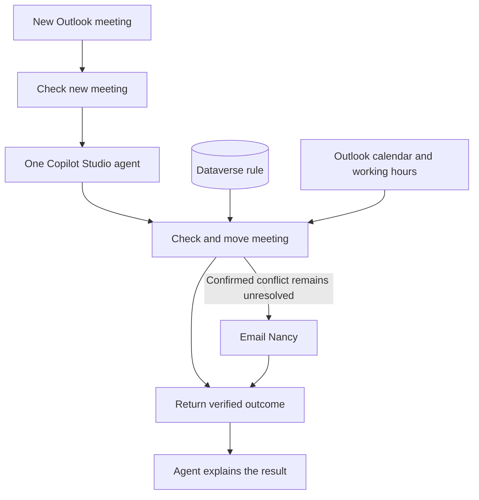

# Zava ExM Meeting Concierge

I built this Dev pilot to explore a practical question: how can an AI agent help with calendar conflicts while fixed checks control every calendar change?

The current solution has **one Copilot Studio agent, one agent tool, two Power Automate flows, and one Dataverse rule table**. Only **Check and move meeting** is exposed as an agent tool.

## What it does

- Protects subjects containing **board meeting**, regardless of capitalization.
- Moves eligible conflicting meetings while keeping their length.
- Uses Outlook working hours and time zone; searches after the original meeting ends through the second following business day, on weekdays only.
- Checks again before changing the calendar and verifies the result afterward.
- Emails Nancy only when a confirmed conflict cannot be fully resolved automatically.

The agent calls one checked process. The flow reads the calendar and rule, finds a time, controls the change, and confirms the outcome. Outlook and Dataverse connections remain inside the flow; separate agent connector tools are unnecessary.

## Start here

| You want to... | Read |
| --- | --- |
| Understand the steps and why they changed | [How it works](docs/architecture.md) |
| Demo it and explain the design | [Demo guide](docs/demo.md) |
| Import or maintain it | [Setup and maintenance](docs/deployment.md) |
| Check the results and their limits | [Test evidence](docs/testing.md) |
| Review access and safeguards | [Security](docs/security.md) |

## Why I built this in Dev

I use **Zava PP Lab Dev** to build, test, and refine the solution before considering a release. One unmanaged solution keeps the agent, flows, rule table, and connection references together as editable source that can be exported and reviewed in Git. It also keeps this project separate from the Default environment, which my lab reserves for personal productivity.

Dev is the first step in my application lifecycle management (ALM) approach. UAT is where a release would be checked before production; Prod is where approved releases would run. This Concierge has been demonstrated in Dev and has not been promoted to UAT or Prod.

For the wider environment structure, access controls, deployment pipelines, and approvals, see my [Zava Power Platform ALM lab](https://github.com/aandino-zava/zava-power-platform-lab), its [architecture and rationale](https://github.com/aandino-zava/zava-power-platform-lab/blob/main/docs/architecture-and-rationale.md), and its [deployment runbook](https://github.com/aandino-zava/zava-power-platform-lab/blob/main/docs/deployment-runbook.md).

## Source and earlier work

- [solution/](solution/README.md): current live Dev export, native source, and fingerprints.
- [scripts/](scripts/README.md): export, validation, local workflow checks, and package commands.
- [Earlier versions](docs/history/README.md): original reports, architecture, tests, and earlier V2 build evidence.

Native platform identifiers and the existing [license](LICENSE) are preserved. This refresh does not change repository visibility or grant a public release.

This is a single-calendar pilot. The supported policy is narrow; recurring and all-day meetings require review. The current starter allows overlapping requests. A durable lock, duplicate-request tracking, stronger caller restrictions, verified production roles, and isolated UAT remain future work.
