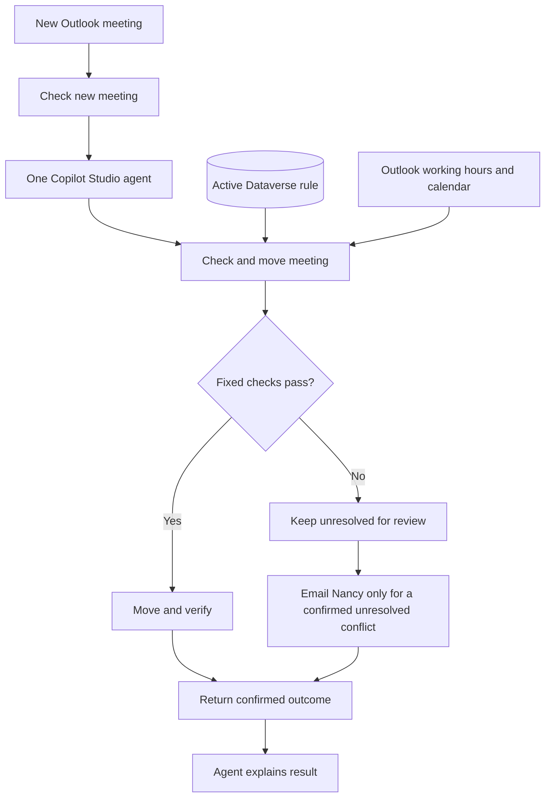

# Zava ExM Meeting Concierge

A Dev implementation that protects board meetings and resolves calendar conflicts using fixed rules. One Copilot Studio agent explains the outcome. Two Power Automate flows handle the automatic trigger and the checked calendar changes.

**Current status:** V2 is installed in Dev. Direct flow tests passed; automatic processing is paused pending approval of the lab owner connection and final end-to-end testing. See the [test record](docs/v2-testing.md).

## What changed in V2

The agent passes the new meeting ID to **Check and move meeting**. It no longer chooses a replacement time or asks a model for permission to change the calendar. The flow reads the actual event and active Dataverse rule, finds a free time, checks again before writing, and verifies the result.

- Protect subjects containing **board meeting**, regardless of capitalization.
- Keep the meeting length and use Outlook's working hours and time zone.
- Search after the original meeting ends, through the second following business day, on weekdays only.
- Email Nancy only when a confirmed conflict cannot be fully resolved automatically.
- Leave recurring and all-day meetings for review.



Read the [V2 design](docs/v2-design.md), [setup notes](docs/implementation.md), [security boundaries](docs/security.md), and [test evidence](docs/v2-testing.md).

## Source and history

The existing solution identity is **ZavaCalendarGovernancePOC**. Display names use simple language; platform schema names stay unchanged so existing references continue to work. The [solution folder](solution/README.md) contains the current native export, unpacked source, and file hashes. The original V1 ZIP and provenance are retained separately. Historical PDFs and [V1 tests](docs/testing.md) describe the earlier implementation.

This is the single-calendar **Zava PP Lab Dev** pilot. It is not a production deployment or a multi-executive service. A durable request ledger, stronger caller restrictions, verified production roles, isolated UAT, and broader policy coverage remain future work.

## Validation

```powershell
python -m pip install PyYAML tzdata
python scripts/validate.py
python scripts/test_resolver.py
./scripts/pack-solution.ps1
```

The Python checks do not call a live service. Live evidence is recorded separately. See [script instructions](scripts/README.md).

## Interview narrative

V1 proved that an agent could coordinate calendar work through a separate write path. Review showed that asking a model inside that path still left permission uncertain. V2 makes the decision repeatable: a small supported policy, fixed checks, one scheduling path, verified outcomes, and an email only when help is needed. The useful architecture lesson is to use AI for communication while keeping business permissions and calendar changes testable.
