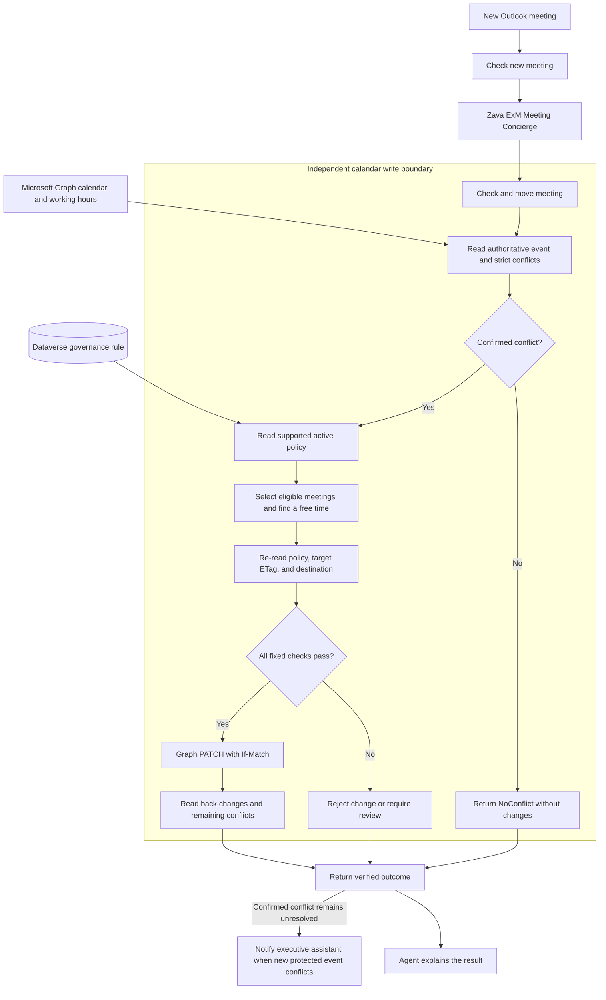

# Zava ExM Meeting Concierge Copilot Agent

## Overview

I built the Zava ExM Meeting Concierge Copilot Agent to explore a practical governance problem: how can I let an AI agent reason about calendar changes while keeping the final write decision in a separate enforcement path?

This proof of concept uses **one Copilot Studio agent, two Power Automate flows, Microsoft Graph, and a governance rule table in Dataverse**. The agent invokes one tool, **Check and move meeting**, and explains its verified result. The flow selects eligible meetings, finds replacement times, and enforces the checks. **Every calendar write goes through this Gatekeeper; the agent cannot authorize a change through its own reasoning.**

The repository contains native solution source, a **deployable solution package**, architecture, deployment guidance, and test evidence. GitHub Actions builds and checks the package, then deploys it to an authorized target environment on request. Each installation supplies its own calendar settings and connections. Independent target deployment and calendar acceptance remain to be verified; production gaps are documented below.

## Design Rationale

Generative models are useful for understanding requests, coordinating actions, and explaining results. Their answers are probabilistic, so business protections need an enforcement path outside the model's instructions.

When a prompt is the only control over calendar changes, the design is exposed to:

1. **Prompt injection:** a request or event description may attempt to override instructions.
2. **Instruction drift and hallucination:** the model may apply a rule inconsistently or invent an authorization.
3. **Maintenance risk:** business policy, scheduling logic, and conversational instructions become difficult to change and test independently.

### The Solution: The Decoupled Gatekeeper Architecture

The design separates policy, intelligence, and execution:

- **Decoupled policy — Dataverse:** the active board-protection rule lives outside the prompt. The flow reads it at runtime and again before a write. The flow recognizes the approved rule explicitly; unsupported policy text blocks automatic resolution.
- **Bounded intelligence — Copilot Studio:** one agent passes the meeting ID to one flow tool and explains the result. It has no separate calendar-write tool and does not supply a replacement time or permission decision.
- **Deterministic enforcement — Power Automate:** the Gatekeeper reads authoritative calendar data, applies fixed eligibility and availability checks, performs a guarded change, and verifies the outcome.

The design keeps time selection and policy enforcement in this single checked process. Model classification does not authorize a calendar change. The Gatekeeper pattern remains the central architectural decision.

## Architecture

The notification label describes the protected-event scenario. The implemented escalation rule also covers other confirmed conflicts that cannot be resolved automatically. A successful automatic resolution sends no email; a read failure that has not established a conflict does not trigger an unresolved-conflict email.

Outlook and Dataverse connections operate inside the flow. Removing their separate agent tools does not remove the flow's connections. This boundary governs the configured agent tool path; the account behind the Outlook connection still has its platform permissions.

## How It Works

1. **Detect a new meeting.** The creation-only Outlook trigger starts **Check new meeting**, which asks the agent to call the Gatekeeper with the event ID.
2. **Read the actual calendar.** The Gatekeeper retrieves the event and overlapping events. It ignores the event itself, cancelled events, free events, and meetings that only touch at an endpoint.
3. **Check the policy.** If a conflict exists, the flow reads active Dataverse rules. Subjects containing **board meeting**, regardless of capitalization, are protected. Empty or unsupported rules stop automatic resolution.
4. **Choose what may move.** If the new meeting is ordinary, move that meeting. If it is protected, move eligible ordinary meetings that conflict with it. Two conflicting protected meetings require review. Recurring and all-day events also require review.
5. **Find a suitable time.** Preserve the full meeting length. Search after the original meeting ends, no earlier than the current time, through the second following business day. Use Outlook working hours and time zone, on weekdays only. Missing or invalid working hours stop the move.
6. **Check again before writing.** Re-read the policy and target event, require an unchanged nonempty ETag, and read the destination again to confirm the full interval is free. The write uses Graph PATCH with **If-Match**, without an automatic retry.
7. **Verify the result.** Read the moved event back and check the original conflict again. Report a resolution only when the selected moves and conflict clearance are confirmed.
8. **Escalate only when needed.** If a confirmed conflict remains unresolved, attempt one notification to the executive assistant. Return the outcome, confirmed move count, need for help, and notification status for the agent to explain.

See [the detailed architecture](docs/architecture.md) for the exact search behavior, result states, and failure handling.

## The Gatekeeper Pattern

The agent can request that a meeting be checked. It cannot turn its explanation, a suggested time, or text in an event into permission to change the calendar. The Gatekeeper accepts the event ID and obtains the facts it needs independently.

The initial reads establish the conflict and identify eligible moves. The final reads check for changed policy, a stale target, and newly occupied destination time. Required read failures, incomplete calendar results, unsupported rules, or failed checks do not permit a write. Post-write reads determine what can be reported as confirmed.

This separation is the reusable pattern: **AI coordinates and explains; a controlled process enforces the business rules and owns the write.** Each read has a purpose, while the agent no longer duplicates the flow's scheduling work.

The checks do not reserve a destination slot or create a transaction across Outlook and Dataverse. An external booking can race with the last availability read, and overlapping requests can compete for a slot. Those limitations require additional controls before production use.

## Natural Language Governance with Dataverse

The demonstrated rule is:

> Board meetings are critical and cannot be moved. Any meeting that has "board meeting" in the subject is considered a board meeting.

Dataverse keeps the policy visible and separate from agent instructions. The flow normalizes this text, recognizes the supported rule, and applies a case-insensitive subject check. It does not ask a model to interpret arbitrary policy prose as authorization.

A new business rule needs a reviewed implementation and tests before automatic enforcement. Editing a row alone cannot grant new permissions. The solution package includes the table definition; active policy rows must be configured in the target environment.

## Zava ExM Meeting Concierge Agent

The agent has one tool: **Check and move meeting**. It passes the meeting ID, invokes the controlled process, and explains the returned outcome. Separate calendar-read, rule-read, and duplicate flow tools have been removed. This is one agent with two flows, rather than a multi-agent system.

Keeping the agent demonstrates Copilot Studio integration and conversational reporting. The fixed scheduling process does not depend on AI to decide whether a calendar change is allowed.

## Microsoft Graph

Graph supplies authoritative event details, calendarView intervals, and working hours through getSchedule. The Gatekeeper uses exact busy-interval endpoints to find a time that fits the meeting's full duration. Its calendar write is a PATCH guarded by the target event's ETag through If-Match, followed by verification reads.

Recurring events can appear in calendar reads, but moving them is outside the supported automatic behavior in this release.

## Power Platform Components

| Exported component | Count | Role |
| --- | ---: | --- |
| Copilot Studio agent | 1 | Invokes the checked process and explains results |
| Agent flow tool | 1 | Exposes Check and move meeting |
| Cloud flows | 2 | Detect a new meeting; check and resolve conflicts |
| Governance table | 1 | Stores the supported business rule |
| Connection references | 3 | Bind target Copilot Studio, Outlook, and Dataverse connections |
| Bot components, including the tool and system topics | 15 | Native agent configuration; includes the single tool above |
| Power Apps form assistance setting (AI Skill Config) | 1 | Disables AI form-fill suggestions for the governance Rule Text field |
| Environment variable definitions | 3 | Calendar mailbox, primary Calendar ID, and Executive assistant email |

The AI Skill Config stores the Rule Text field's `FormFillFieldOptOut` setting. It has no role in meeting classification, scheduling, or calendar-write authorization.

Dataverse actions remain within the calendar flow. Counts describe exported components, rather than every connection used by an action. See [setup and maintenance](docs/deployment.md) for native definitions and connection binding details.

## Test Scenarios

Recorded live evidence covers no conflict, a resolved ordinary-meeting conflict with the board meeting preserved, and two protected meetings requiring help. The resolved case sent no notification; the unresolved protected conflict submitted an assistant email. Calendar times and notification results were checked beyond the parent flow's success status.

The repository includes **27 local workflow simulations** against the flow definitions, plus package and deployment-script checks. These use simulated services and are separate from live platform tests. The GitHub Actions workflow builds and checks source automatically, with tenant deployment available only through an explicit manual run. The receiving tenant's independent deployment and calendar acceptance results are recorded separately.

See [test evidence and its limits](docs/testing.md). To verify an installation, follow the [calendar acceptance scenarios](docs/deployment.md#test-the-installed-solution).

## Key Design Decisions

- Keep policy outside the prompt, with a fresh read before a write.
- Give the agent one controlled tool and keep calendar mutation inside the Gatekeeper.
- Use fixed policy checks and exact availability intervals for repeatable behavior.
- Preserve meeting duration and use Outlook working hours rather than a fallback schedule.
- Verify actual calendar outcomes before reporting success.
- Notify the executive assistant only for confirmed conflicts that remain unresolved.
- Preserve native solution identities and export evidence for maintainability.

## Why I built this in Dev

I placed the whole solution in **Zava PP Lab Dev** because this is where I build, test, and refine it. I needed room to adjust the agent, change the rules, and troubleshoot the flows without putting unfinished changes into UAT or Prod.

Keeping the agent, flows, rule table, and connection references together in one unmanaged solution gives me an editable starting point and a package I can export and track in Git. It also keeps this project separate from the Default environment, which my lab design reserves for personal productivity.

Dev is the first step in my application lifecycle management (ALM) approach. UAT is where a release would be checked before production, and Prod is where approved changes would be deployed. This Concierge implementation has been built and demonstrated in Dev; I have not promoted it to UAT or Prod.

For instructions on setting up that environment structure, access controls, deployment pipelines, and approvals, visit my [Zava Power Platform ALM lab repository](https://github.com/aandino-zava/zava-power-platform-lab). Start with its [architecture and rationale](https://github.com/aandino-zava/zava-power-platform-lab/blob/main/docs/architecture-and-rationale.md), then follow the [deployment runbook](https://github.com/aandino-zava/zava-power-platform-lab/blob/main/docs/deployment-runbook.md).

## Deployment and Import Notes

Use the [GitHub Actions deployment guide](docs/deployment.md) to build, check, and import **Zava ExM Meeting Concierge** into a configured target environment.

**First-time authorization is required in the receiving tenant. Its administrator must authorize the deployment identity, create the account connections, and provide the target settings.** The workflow uses federated sign-in without a stored client secret. It imports the checked artifact and verifies components; the administrator then completes rule data, agent authentication/publication, and calendar acceptance checks before enabling processing.

For readers who prefer a downloaded ZIP or cannot use GitHub Actions, [manual installation](docs/manual-install.md) is an alternative using [ZavaExMMeetingConcierge.zip](solution/exports/ZavaExMMeetingConcierge.zip). Both routes use the same solution and Gatekeeper controls.

The installed calendar must be the connected Outlook account's **primary calendar**. No lab mailbox, calendar ID, or recipient is embedded in the current flows. Package and local workflow checks do not establish a successful tenant deployment; see [test evidence](docs/testing.md). Review [security](docs/security.md) before deployment. This project is open source under the [MIT License](LICENSE); see [third-party notices](NOTICE) for platform and service terms.

## POC Scope and Limitations

This is a single-calendar pilot with one supported policy. Recurring and all-day meetings require manual review, automatic resolution is limited to ten moves per request, and the search does not model holidays. Missing data and unsupported rules stop automatic changes.

The current starter has no concurrency control configured. Automatic and direct requests lack a durable mailbox lock and duplicate-request tracking. An ETag protects the target event against stale updates but does not reserve the destination. A request ledger, stronger caller restrictions, verified production roles, broader policy scope, and isolated UAT remain production work.
